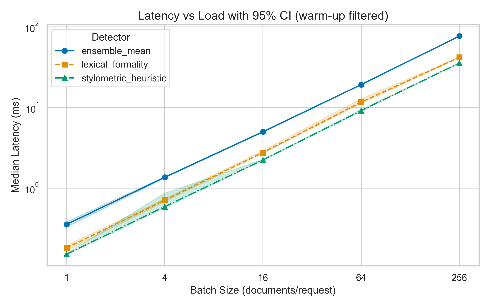
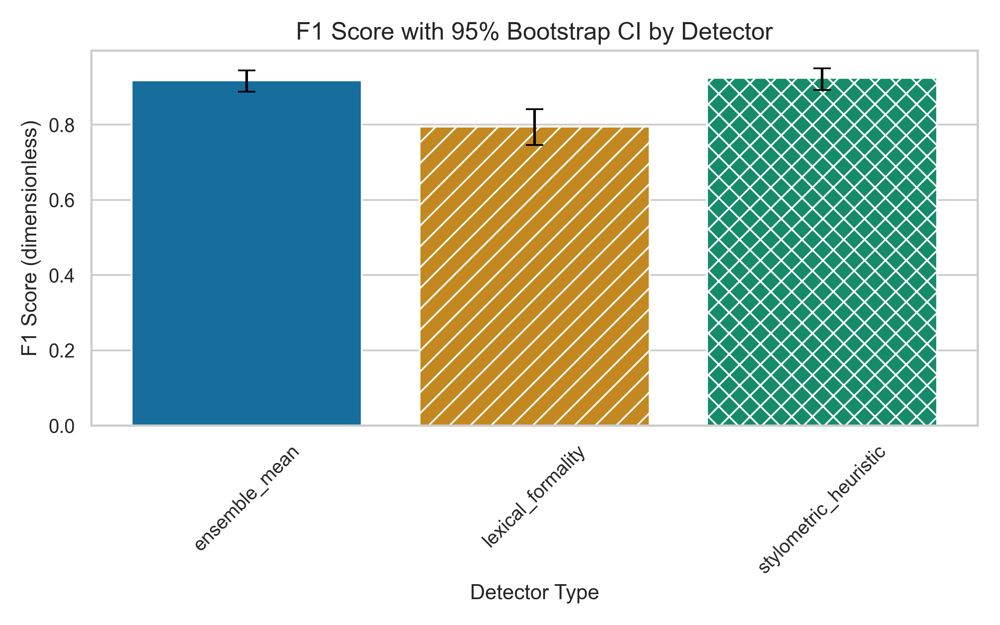

# Evaluating AI-Text Detectors in Academic Writing: Performance on Hybrid Human–AI Texts

**Authors:** Aruzhan Abulgazinova, Aruzhan Kinayatova


## Research Question
How do watermarking, zero-shot and classifier-based AI-text detectors perform on **hybrid** (partially human-edited, partially AI-generated) academic texts, how do AI-content proportion and AI-segment length affect them, and does an ensemble outperform single detectors?
Hypotheses (H0/H1), the variable matrix, metrics and the baseline are specified in [`docs/methodology_card.md`](docs/methodology_card.md).

## Overview
A reproducible benchmarking harness. Independent variables (detectors, decision threshold, data path, number of runs) live in `configs/config.yaml`. `src/main.py` runs every configured detector on a labelled CSV and writes:
- quality metrics: **F1 (primary)**, AUROC, FNR;
- guardrail metrics: FPR on pure-human text, latency, peak RAM, errors;
- per-document scores (for the statistical tests in `src/stats.py`).

**Status:** reproducible Task 3 benchmark with committed raw logs, processed summaries, and figures. The built-in detectors are transparent CPU-only smoke-test baselines; these synthetic-corpus results are not claims about production detectors.

## System Requirements
- Docker ≥ 24, **or** Python 3.11 (CI and Docker image use 3.11.9; also verified on 3.12)
- CPU only; ≥ 2 GB RAM for the sample run (≈ 8 GB for neural detectors)
- Internet only for the optional neural detector (`requirements-hf.txt`)

## Quickstart
```bash
git clone https://github.com/akinayat-stack/Evaluating-the-Effectiveness-of-AI-Text-Detectors-in-Academic-Writing.git && cd Evaluating-the-Effectiveness-of-AI-Text-Detectors-in-Academic-Writing
docker build -t ai-detect-bench .
docker run --rm -v "$(pwd)/results:/app/results" ai-detect-bench
```
Without Docker:
```bash
python -m venv .venv && source .venv/bin/activate
pip install -r requirements.txt && python src/main.py --config configs/config.yaml
```
Outputs in `results/`: `summary.csv`, `results.csv`, `results.json`, `scores.csv`, `run.log`.

Tests: `python -m unittest discover -s tests`
Paired bootstrap for two detectors: `python src/stats.py results/scores.csv --a ensemble_mean --b stylometric_heuristic`

## Repository Structure
```
├── README.md  LICENSE  CITATION.cff  .gitignore  .dockerignore
├── Dockerfile  requirements.txt  requirements-hf.txt
├── .github/workflows/ci.yml   # tests + docker build on every push
├── configs/config.yaml        # experiment parameters (independent variables)
├── data/raw/
│   ├── corpus.csv             # labelled corpus
│   ├── doc_scores.jsonl       # per-document detector scores
│   └── test_run.jsonl         # warm-up and evaluation latency logs
├── data/processed/            # committed reproducibility summaries
├── src/
│   ├── main.py                # entry point
│   ├── benchmark.py           # measurement + guardrails
│   ├── detectors.py           # detector implementations
│   ├── process_data.py        # bootstrap metrics and statistical summaries
│   ├── visualize.py           # publication-ready figures
│   └── stats.py               # paired bootstrap for H1b / H2b
├── tests/test_pipeline.py
├── notebooks/01_data_analysis.ipynb
├── docs/methodology_card.md
├── reports/figures/           # generated figures
└── results/                   # optional run outputs (git-ignored)
```

## Planned Benchmarks
| ID | Varied (independent) | Measured (dependent) | Hypothesis / test |
|----|----------------------|----------------------|-------------------|
| B1 | Detector type × text category | F1, AUROC | H1, H1b — two-way ANOVA, paired bootstrap |
| B2 | AI-content proportion (0–100 %) | Probability of correct detection | H2a — logistic regression |
| B3 | Ensemble vs best single detector | F1 | H2b — paired bootstrap |
| B4 | AI-segment length (25–400 tokens) | FNR | H3 — χ² / Cochran–Armitage |

## Data format
`id,text,label,category,ai_fraction,ai_segment_tokens,split` — `label=1` means the text contains AI-generated content (pure-AI or hybrid); `label=0` is pure human.

## Citation / License
Released under the MIT License (see `LICENSE`). Cite via `CITATION.cff` or:
```bibtex
@software{abulgazinova_kinayatova_2026,
  author = {Abulgazinova, Aruzhan and Kinayatova, Aruzhan},
  title  = {Evaluating AI-text detectors on hybrid academic texts},
  year   = {2026},
  url    = {https://github.com/akinayat-stack/Evaluating-the-Effectiveness-of-AI-Text-Detectors-in-Academic-Writing}
}
```
## Results & Discussion (TASK 3)

### Benchmark Summary (Test Split)
*Results are based on the synthetic corpus. The baseline is `stylometric_heuristic`;
the proposed method is `ensemble_mean`. F1 is reported with a 95% bootstrap CI.*

| Detector | Role | F1 Score | F1 95% CI | FPR (Human) | Guardrail Status |
|----------|------|-----------|-------------|-------------|------------------|
| ensemble_mean | Proposed method | 0.917 | [0.888, 0.945] | 0.100 | ❌ Fail |
| stylometric_heuristic | Baseline | 0.924 | [0.893, 0.950] | 0.071 | ❌ Fail |
| lexical_formality | Single detector | 0.795 | [0.746, 0.842] | 0.121 | ❌ Fail |
| random_baseline | Sanity baseline | 0.157 | [0.093, 0.222] | 0.079 | ❌ Fail |

### Scientific Plots
The random baseline is retained in the metrics table as a chance reference but
is omitted from the plots so the detector comparison remains readable.




### Latency Summary (batch size 16)

| Detector | Median ms (p25–p75) | p95 ms | p99 ms |
|----------|---------------------|--------|--------|
| ensemble_mean | 4.994 (4.910–5.199) | 6.286 | 7.151 |
| stylometric_heuristic | 2.238 (2.206–2.316) | 2.461 | 3.349 |
| lexical_formality | 2.764 (2.653–3.078) | 4.595 | 5.539 |
| random_baseline | 0.010 (0.010–0.011) | 0.015 | 0.018 |

All four detectors exceed the strict FPR ≤ 5% guardrail on this synthetic test
split, so every row is marked as a failure even though the quality and latency
results are otherwise informative. The FPR result limits claims about safe use
on human-only text and motivates threshold or calibration work before deployment.

### Domain Model
The formal definition of metrics, target variables, and LaTeX notation is available in [`docs/domain_model.md`](docs/domain_model.md).
