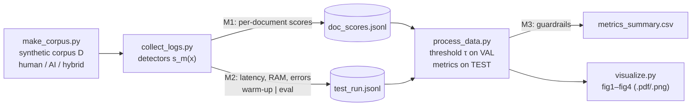

# Domain Model — Task 3 (Machine Learning / AI track)

Formal definition of the detection task, the loss / calibration objective, the target metrics and the
statistical tests used in this study. Notation is summarised in §6. (Math renders on GitHub.)

## 1. System view and measurement points

M1 = quality signal (scores), M2 = performance signal (latency/RAM/errors), M3 = guardrail verdicts.

## 2. Task definition

Let $\mathcal{X}$ be the set of academic texts and $y\in\{0,1\}$ the label "contains AI-generated content"
($y=0$ pure human; $y=1$ pure-AI **or hybrid**). A corpus is $\mathcal{D}=\{(x_i,y_i)\}_{i=1}^{N}$, split into
validation $\mathcal{D}_{\text{val}}$ and test $\mathcal{D}_{\text{test}}$.

A **detector** $m$ is a scoring function $s_m:\mathcal{X}\to[0,1]$ ("probability that $x$ contains AI text") with the
frozen decision rule

$$\hat y_m(x)=\mathbb{1}\left[s_m(x)\ge\tau_m\right].$$

**Hybrid text structure.** For a document of $T$ tokens with AI-token set $A(x)$:

$$\rho(x)=\frac{|A(x)|}{T}\quad(\text{AI-content proportion}),\qquad
\ell(x)=\max\text{ length of a contiguous run inside }A(x)\quad(\text{AI-segment length}).$$

In this repository tokens are whitespace-separated words.

**Ensemble (proposed method).** For a member set $\mathcal{M}$ (non-baseline detectors)

$$s_{\text{ens}}(x)=\frac{1}{|\mathcal{M}|}\sum_{m\in\mathcal{M}}s_m(x),\qquad\text{or}\qquad
s_{\text{ens}}^{\mathbf w}(x)=\sum_{m}w_m s_m(x),\ \ w_m\ge 0,\ \sum_m w_m=1 .$$

The uniform mean is what is implemented (`EnsembleMean`); learned weights $\mathbf w$ are planned once real detectors exist.

## 3. Loss function and calibration objective

**(a) Trained classifiers** (RoBERTa detector, Ghostbuster-like; Week 7+ real detectors) minimise the regularised
binary cross-entropy

$$\mathcal{L}(\theta)=-\frac{1}{|\mathcal{D}_{\text{train}}|}\sum_{(x,y)\in\mathcal{D}_{\text{train}}}
\Big[y\log s_\theta(x)+(1-y)\log\big(1-s_\theta(x)\big)\Big]+\lambda\lVert\theta\rVert_2^2 .$$

**(b) Training-free detectors** (the transparent heuristics implemented now; zero-shot Binoculars/DetectGPT; watermark
z-test) have no trainable $\theta$, so there is no $\mathcal{L}(\theta)$. They are made comparable by one shared
**threshold-calibration objective**, solved once on $\mathcal{D}_{\text{val}}$ and then frozen:

$$\tau_m^{\star}=\arg\max_{\tau}\ F_1\big(\tau;\mathcal{D}_{\text{val}}\big)\quad\text{s.t.}\quad
\mathrm{FPR}_{\text{human}}\big(\tau;\mathcal{D}_{\text{val}}\big)\le\alpha=0.05 .$$

If no $\tau$ is feasible, the $\tau$ with the smallest FPR is used and the detector is reported as failing the guardrail.
Rationale: a false accusation of a student is costlier than a miss (see `methodology_card.md`, §5).

## 4. Target metrics, guardrails, load metrics

With $TP,FP,FN,TN$ counted on $\mathcal{D}_{\text{test}}$:

$$\mathrm{F1}=\frac{2\,TP}{2\,TP+FP+FN}\ (\text{primary}),\qquad
\mathrm{FNR}=\frac{FN}{TP+FN},\qquad
\mathrm{FPR}_{\text{human}}=\frac{FP}{FP+TN},$$

$$\mathrm{AUROC}=\Pr\big[s(x^{+})>s(x^{-})\big]+\tfrac12\Pr\big[s(x^{+})=s(x^{-})\big].$$

**Guardrails** (checked per detector): $\mathrm{FPR}_{\text{human}}\le 5\,\%$; no exceptions / NaN scores;
$p_{99}$ latency $\le 10\,\text{s}$ per document; peak RAM $\le 8\,\text{GB}$.

**Load metrics.** For load $B$ (documents per request) and $n$ evaluation repetitions (warm-up repetitions
$\mathcal{W}$ are discarded) with latencies $\{t_j(B)\}_{j\notin\mathcal{W}}$:

$$\tilde t(B)=\operatorname{median}_j\,t_j(B),\qquad p_q(B)=\text{empirical }q\text{-quantile},\ q\in\{0.95,0.99\},$$

with a percentile bootstrap 95 % CI $[\,t^{*}_{(0.025)},\,t^{*}_{(0.975)}\,]$ of $\tilde t(B)$ from $R=2000$ resamples (seed 42).

## 5. Hypotheses and tests (links to `methodology_card.md`)

| ID | Statistical model / test | Implemented in |
|---|---|---|
| H2a | $\operatorname{logit}\Pr[\hat y=1\mid\rho]=\beta_0+\beta_1\rho$ on AI-containing docs; $H_0:\beta_1=0$ vs $H_1:\beta_1>0$ (bootstrap) | `process_data.logistic_slope_h2a` |
| H2b | $\Delta F_1=F_1(\text{ens})-F_1(\text{best single})$, paired bootstrap, $H_1:\Delta F_1>0$ | `stats.paired_bootstrap_f1` |
| H3 | $H_1:\mathrm{FNR}(\ell\le 50)>\mathrm{FNR}(\ell\ge 200)$, one-sided Fisher exact; Cochran–Armitage trend on $\log\ell$ | `process_data.segment_length_h3` |

Primary tests (H2a, H2b, H3 for the ensemble) are Holm-corrected at $\alpha=0.05$. H1 / H1b need watermark, zero-shot
and classifier detectors that do not exist yet in the repository, so they are **not tested** in this release.
Proportions use Wilson 95 % intervals.

## 6. Notation

| Symbol | Meaning | Unit / range |
|---|---|---|
| $x\in\mathcal{X}$ | an academic text | ≈ 450 words |
| $y$ | label: 1 = contains AI text, 0 = pure human | {0, 1} |
| $\mathcal{D},\mathcal{D}_{\text{val}},\mathcal{D}_{\text{test}}$ | corpus; validation (30 %) / test (70 %) split | documents |
| $m,\ \mathcal{M}$ | a detector; set of ensemble members | – |
| $s_m(x)$ | detector score | [0, 1], unitless |
| $\tau_m$ | frozen decision threshold | [0, 1] |
| $\hat y_m(x)$ | predicted label | {0, 1} |
| $\theta,\ \lambda$ | trainable parameters; L2 weight (trained classifiers only) | – |
| $\mathcal{L}(\theta)$ | binary cross-entropy loss | nats |
| $\rho(x)$ | AI-content proportion | 0–100 % of words |
| $\ell(x)$ | longest contiguous AI segment | words |
| $\alpha$ | FPR guardrail level (0.05) | – |
| $TP,FP,FN,TN$ | confusion-matrix counts on $\mathcal{D}_{\text{test}}$ | documents |
| $F_1$, FNR, $\mathrm{FPR}_{\text{human}}$, AUROC | target metrics | [0, 1] |
| $B$ | load = batch size | documents / request |
| $t_j(B)$, $\tilde t(B)$, $p_q(B)$ | latency of run $j$; median; $q$-quantile | ms / request |
| $\mathcal{W}$ | discarded warm-up repetitions | runs |
| $R$ | number of bootstrap resamples (2000) | – |
| $\beta_0,\beta_1$ | logistic-regression coefficients (H2a) | logit, logit per unit $\rho$ |